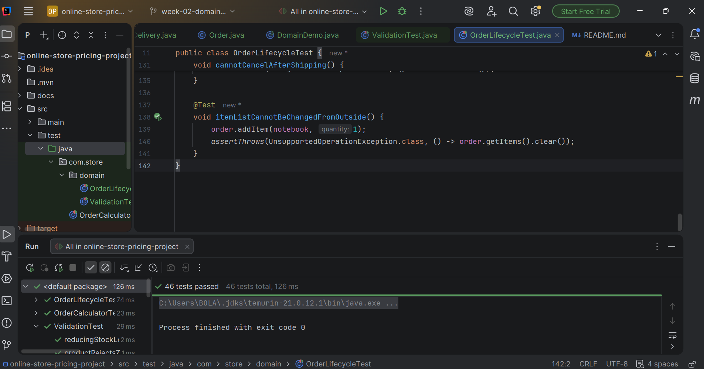
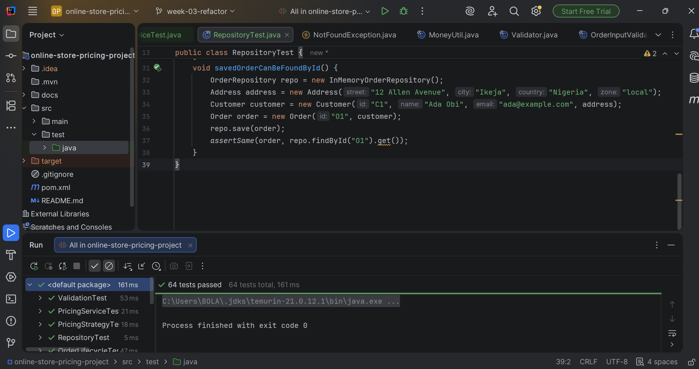

# Online Store Order Pricing Calculator

A console Java application that calculates an online order's subtotal, discount, delivery fee, tax and final amount.

## Setup

Requirements: JDK 21, Maven, IntelliJ IDEA (or any IDE).

1. Clone the repository.
2. Open it in IntelliJ as a Maven project (select `pom.xml`).
3. Run the tests: right-click `src/test/java` > Run 'All Tests', or run `mvn test`.
4. Run the app: open `ConsoleApp.java` and click the green arrow beside `main`.

## Project structure

- `OrderCalculator.java`: all business rules (no console code)
- `OrderResult.java`: holds the calculated results
- `ConsoleApp.java`: asks the user for input and prints the receipt
- `OrderCalculatorTest.java`: 16 JUnit 5 tests

Calculation logic is kept separate from console input and output, so the rules can be tested without typing anything.

## Business rules

1. Subtotal 100 or more gets a 10% discount. Subtotal 50 or more gets 5%.
2. Buying 10 or more items in total gets an extra 3% discount.
3. Loyalty members get an extra 5% discount.
4. Discounts add together, with a maximum of 15% in total.
5. Delivery: local 5, regional 12, international 30.
6. Free delivery if the subtotal is 80 or more (local) or 200 or more (regional). International delivery is never free.
7. Tax is 7.5% of the discounted subtotal. Delivery is not taxed.
8. Final amount = discounted subtotal + delivery + tax.

## Input validation

- 1 to 20 different items
- Price greater than 0 and at most 100000
- Quantity from 1 to 100
- Location must be local, regional or international
- Invalid input shows a clear message, and the program asks again

## Usage example

```
How many different items? (1-20): 1
Item 1 unit price: 100
Item 1 quantity (1-100): 1
Delivery location (local / regional / international): local
Loyalty member? (y/n): n

---------- RECEIPT ----------
Subtotal:              100.00
Discount (10.0%):      -10.00
After discount:         90.00
Delivery (local):        0.00
Tax (7.5%):              6.75
-----------------------------
FINAL AMOUNT:           96.75
```

More examples are in [docs/sample-io.md](docs/sample-io.md).

## Tests

16 tests covering normal cases, delivery fees, boundaries (49.99 vs 50, 79.99 vs 80, 9 vs 10 items) and invalid input.


## Week 2: Order domain model

The package `com.store.domain` models an e-commerce order system and reuses the Week 1 pricing rules.

| Type | Kind | Purpose |
|------|------|---------|
| Customer | class | Name, email, address, loyalty status |
| Product | class | Name, price, stock (stock goes down when ordered) |
| Order | class | Holds items, status, payment and delivery |
| Payment | class | Amount, method and payment status |
| Delivery | class | Delivery address and status |
| Address | record | Immutable address with delivery zone |
| OrderItem | record | Immutable order line (product, quantity, price at order time) |
| OrderStatus, PaymentStatus, PaymentMethod, DeliveryStatus | enums | Fixed sets of values |

### Relationships

- A Customer places many Orders.
- An Order contains many OrderItems, and each OrderItem refers to one Product.
- An Order has at most one Payment and one Delivery.
- Customer and Delivery both use an Address.

### Order life cycle

```
NEW -> PAID -> SHIPPED -> DELIVERED
 |       |
 +-------+--> CANCELLED (not possible after shipping)
```

Diagram: [docs/class-diagram.md](docs/class-diagram.md)
Design decisions: [docs/design-notes.md](docs/design-notes.md)

Run the demo: open `DomainDemo.java` and click the green arrow beside `main`.
Run the tests: right-click `src/test/java` > Run 'All Tests' (46 tests).



## Week 3: Refactoring for maintainability

The project was reorganised from two packages into layered packages.
Behaviour did not change: all Week 1 and Week 2 tests still pass.

Package diagram (before and after): [docs/package-diagram.md](docs/package-diagram.md)
Code review checklist: [docs/code-review-checklist.md](docs/code-review-checklist.md)

| Package | Responsibility |
|---------|----------------|
| `model` | Entities, records and enums |
| `pricing` | Discount and shipping rules, and the service that combines them |
| `validation` | Shared validation rules |
| `exception` | Clear exception types |
| `util` | Small helpers |
| `repository` | Storing and finding products and orders |
| `service` | Coordinating the steps of an order |
| `app` | Console programs |

### Major refactoring decisions

1. **`DiscountPolicy` interface**: Week 1 had three discount rules in one method. Each is now its own class, so a new rule means a new class and no change to `PricingService`.
2. **`ShippingCalculator` interface**: delivery pricing can be swapped (zone-based or flat rate).
3. **Composition**: `PricingService` is built from a list of policies and a shipping calculator. It does not inherit from anything.
4. **Repository interfaces**: storage is hidden behind `ProductRepository` and `OrderRepository`, so a database can replace the in-memory versions later.
5. **`Validator`**: price, quantity, text, email and location rules were repeated in several classes. They now live in one place.
6. **Small methods**: `Order` and `OrderInputValidator` had long methods; they are now split into short, named ones.
7. **Duplicate logic removed**: `Payment` and `Delivery` share one `changeStatus` helper each.
8. **Custom exceptions** extend the standard ones, so old tests and code still work.
9. **Interfaces avoided where not needed**: `Order`, `Product` and the other model classes have only one version each, so they stay plain classes.

### Pull request
https://github.com/AfapeSeyi1234/online-store-pricing/pull/ (add the number)

Run the tests: right-click `src/test/java` > Run 'All Tests' (64 tests).

