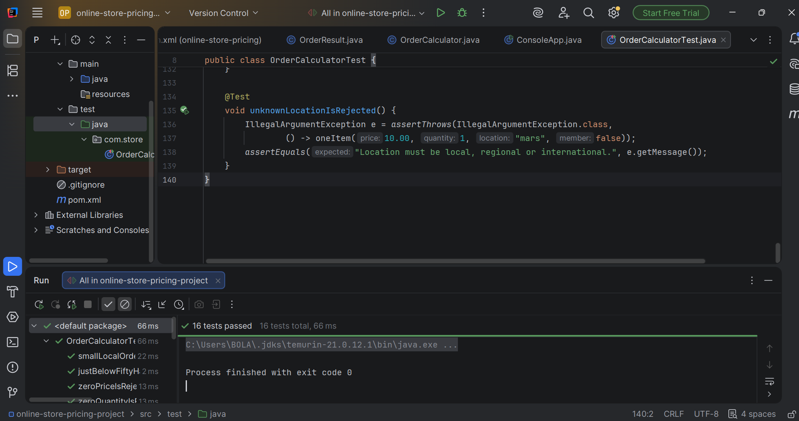

# Online Store Order Pricing Calculator

A console Java application that calculates an online order's subtotal, discount, delivery fee, tax and final amount.

## Setup

Requirements: JDK 21, Maven, IntelliJ IDEA (or any IDE).

1. Clone the repository.
2. Open it in IntelliJ as a Maven project (select `pom.xml`).
3. Run the tests: right-click `src/test/java` > Run 'All Tests', or run `mvn test`.
4. Run the app: open `ConsoleApp.java` and click the green arrow beside `main`.

## Project structure

- `OrderCalculator.java`: all business rules (no console code)
- `OrderResult.java`: holds the calculated results
- `ConsoleApp.java`: asks the user for input and prints the receipt
- `OrderCalculatorTest.java`: 16 JUnit 5 tests

Calculation logic is kept separate from console input and output, so the rules can be tested without typing anything.

## Business rules

1. Subtotal 100 or more gets a 10% discount. Subtotal 50 or more gets 5%.
2. Buying 10 or more items in total gets an extra 3% discount.
3. Loyalty members get an extra 5% discount.
4. Discounts add together, with a maximum of 15% in total.
5. Delivery: local 5, regional 12, international 30.
6. Free delivery if the subtotal is 80 or more (local) or 200 or more (regional). International delivery is never free.
7. Tax is 7.5% of the discounted subtotal. Delivery is not taxed.
8. Final amount = discounted subtotal + delivery + tax.

## Input validation

- 1 to 20 different items
- Price greater than 0 and at most 100000
- Quantity from 1 to 100
- Location must be local, regional or international
- Invalid input shows a clear message, and the program asks again

## Usage example

```
How many different items? (1-20): 1
Item 1 unit price: 100
Item 1 quantity (1-100): 1
Delivery location (local / regional / international): local
Loyalty member? (y/n): n

---------- RECEIPT ----------
Subtotal:              100.00
Discount (10.0%):      -10.00
After discount:         90.00
Delivery (local):        0.00
Tax (7.5%):              6.75
-----------------------------
FINAL AMOUNT:           96.75
```

More examples are in [docs/sample-io.md](docs/sample-io.md).

## Tests

16 tests covering normal cases, delivery fees, boundaries (49.99 vs 50, 79.99 vs 80, 9 vs 10 items) and invalid input.



