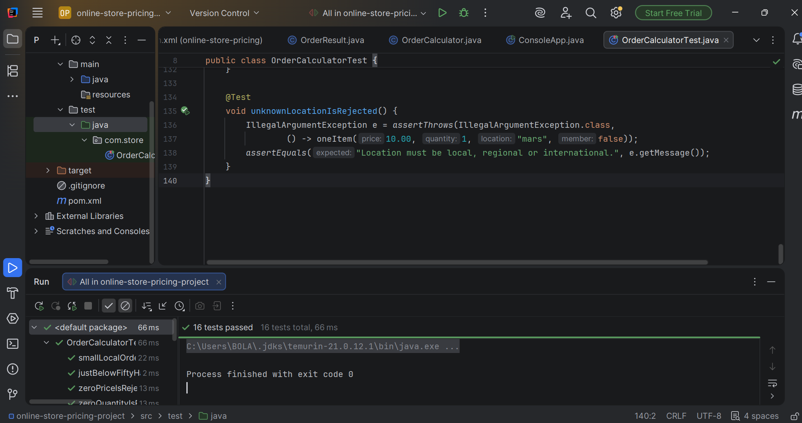
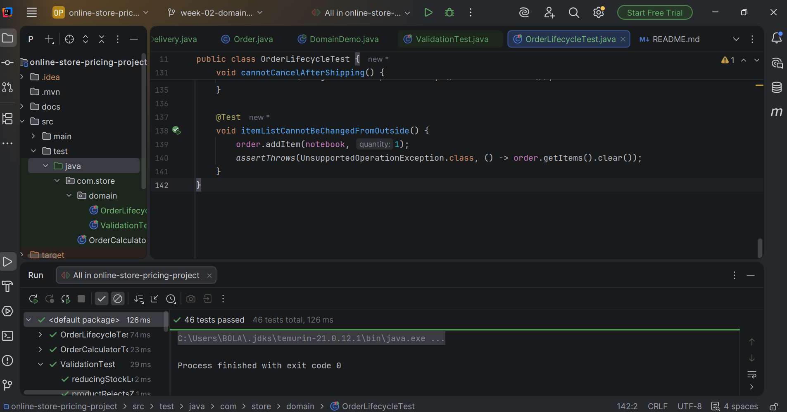
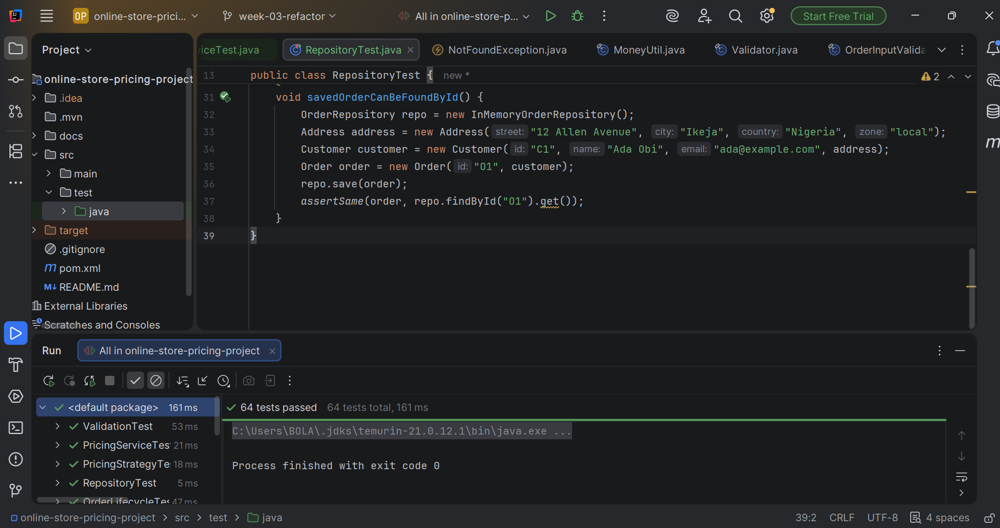
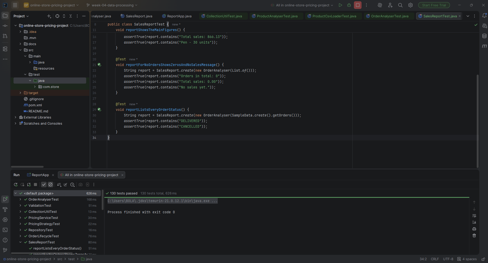
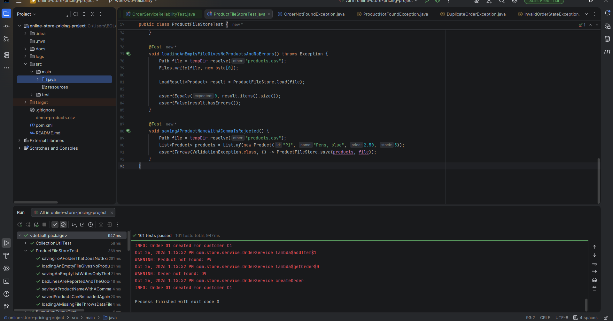
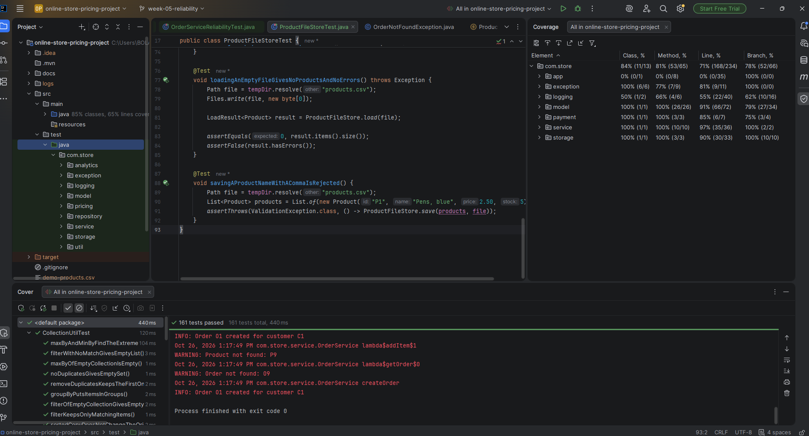
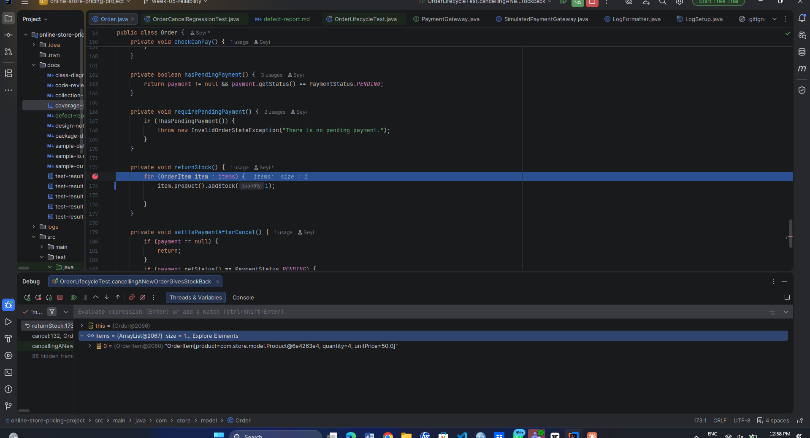
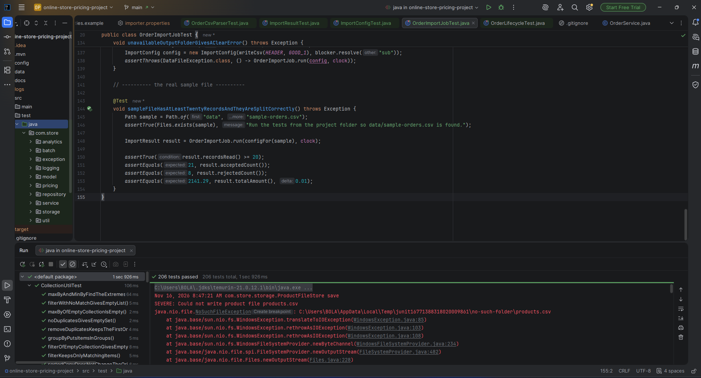

# Online Store Order Pricing Calculator

A console Java application that calculates an online order's subtotal, discount, delivery fee, tax and final amount.

## Setup

Requirements: JDK 21, Maven, IntelliJ IDEA (or any IDE).

1. Clone the repository.
2. Open it in IntelliJ as a Maven project (select `pom.xml`).
3. Run the tests: right-click `src/test/java` > Run 'All Tests', or run `mvn test`.
4. Run the app: open `ConsoleApp.java` and click the green arrow beside `main`.

## Project structure

- `OrderCalculator.java`: all business rules (no console code)
- `OrderResult.java`: holds the calculated results
- `ConsoleApp.java`: asks the user for input and prints the receipt
- `OrderCalculatorTest.java`: 16 JUnit 5 tests

Calculation logic is kept separate from console input and output, so the rules can be tested without typing anything.

## Business rules

1. Subtotal 100 or more gets a 10% discount. Subtotal 50 or more gets 5%.
2. Buying 10 or more items in total gets an extra 3% discount.
3. Loyalty members get an extra 5% discount.
4. Discounts add together, with a maximum of 15% in total.
5. Delivery: local 5, regional 12, international 30.
6. Free delivery if the subtotal is 80 or more (local) or 200 or more (regional). International delivery is never free.
7. Tax is 7.5% of the discounted subtotal. Delivery is not taxed.
8. Final amount = discounted subtotal + delivery + tax.

## Input validation

- 1 to 20 different items
- Price greater than 0 and at most 100000
- Quantity from 1 to 100
- Location must be local, regional or international
- Invalid input shows a clear message, and the program asks again

## Usage example

```
How many different items? (1-20): 1
Item 1 unit price: 100
Item 1 quantity (1-100): 1
Delivery location (local / regional / international): local
Loyalty member? (y/n): n

---------- RECEIPT ----------
Subtotal:              100.00
Discount (10.0%):      -10.00
After discount:         90.00
Delivery (local):        0.00
Tax (7.5%):              6.75
-----------------------------
FINAL AMOUNT:           96.75
```

More examples are in [docs/sample-io.md](docs/sample-io.md).

## Tests

16 tests covering normal cases, delivery fees, boundaries (49.99 vs 50, 79.99 vs 80, 9 vs 10 items) and invalid input.




## Week 2: Order domain model

The package `com.store.domain` models an e-commerce order system and reuses the Week 1 pricing rules.

| Type | Kind | Purpose |
|------|------|---------|
| Customer | class | Name, email, address, loyalty status |
| Product | class | Name, price, stock (stock goes down when ordered) |
| Order | class | Holds items, status, payment and delivery |
| Payment | class | Amount, method and payment status |
| Delivery | class | Delivery address and status |
| Address | record | Immutable address with delivery zone |
| OrderItem | record | Immutable order line (product, quantity, price at order time) |
| OrderStatus, PaymentStatus, PaymentMethod, DeliveryStatus | enums | Fixed sets of values |

### Relationships

- A Customer places many Orders.
- An Order contains many OrderItems, and each OrderItem refers to one Product.
- An Order has at most one Payment and one Delivery.
- Customer and Delivery both use an Address.

### Order life cycle

```
NEW -> PAID -> SHIPPED -> DELIVERED
 |       |
 +-------+--> CANCELLED (not possible after shipping)
```

Diagram: [docs/class-diagram.md](docs/class-diagram.md)
Design decisions: [docs/design-notes.md](docs/design-notes.md)

Run the demo: open `DomainDemo.java` and click the green arrow beside `main`.
Run the tests: right-click `src/test/java` > Run 'All Tests' (46 tests).



## Week 3: Refactoring for maintainability

The project was reorganised from two packages into layered packages.
Behaviour did not change: all Week 1 and Week 2 tests still pass.

Package diagram (before and after): [docs/package-diagram.md](docs/package-diagram.md)
Code review checklist: [docs/code-review-checklist.md](docs/code-review-checklist.md)

| Package | Responsibility |
|---------|----------------|
| `model` | Entities, records and enums |
| `pricing` | Discount and shipping rules, and the service that combines them |
| `validation` | Shared validation rules |
| `exception` | Clear exception types |
| `util` | Small helpers |
| `repository` | Storing and finding products and orders |
| `service` | Coordinating the steps of an order |
| `app` | Console programs |

### Major refactoring decisions

1. **`DiscountPolicy` interface**: Week 1 had three discount rules in one method. Each is now its own class, so a new rule means a new class and no change to `PricingService`.
2. **`ShippingCalculator` interface**: delivery pricing can be swapped (zone-based or flat rate).
3. **Composition**: `PricingService` is built from a list of policies and a shipping calculator. It does not inherit from anything.
4. **Repository interfaces**: storage is hidden behind `ProductRepository` and `OrderRepository`, so a database can replace the in-memory versions later.
5. **`Validator`**: price, quantity, text, email and location rules were repeated in several classes. They now live in one place.
6. **Small methods**: `Order` and `OrderInputValidator` had long methods; they are now split into short, named ones.
7. **Duplicate logic removed**: `Payment` and `Delivery` share one `changeStatus` helper each.
8. **Custom exceptions** extend the standard ones, so old tests and code still work.
9. **Interfaces avoided where not needed**: `Order`, `Product` and the other model classes have only one version each, so they stay plain classes.

### Pull request
https://github.com/AfapeSeyi1234/online-store-pricing/pull/ (add the number)

Run the tests: right-click `src/test/java` > Run 'All Tests' (64 tests).




## Week 4: Order and sales analyser

A console program that processes products, customers and orders with Java collections, generics and streams.

### Setup and usage
1. Open the project in IntelliJ as a Maven project.
2. Open `src/main/java/com/store/app/ReportApp.java` and click the green arrow beside `main`.
3. Choose an option from the menu (1 to 10, 0 to exit).
4. Run the tests: right-click `src/test/java` > Run 'All Tests' (add your real test count here).

| Menu option | What it does |
|-------------|--------------|
| 1, 2 | Search products or orders |
| 3 | Sort products by name, price or stock |
| 4, 5, 6, 7 | Filter orders by status, customer, date range or value range |
| 8 | Group orders by customer or status |
| 9 | Check product data for duplicates and invalid records |
| 10 | Sales summary: total sales, average order value, best sellers |

### Package structure (new in Week 4)
- `analytics`: `ProductAnalyser`, `OrderAnalyser`, `SalesReport`, `ProductCsvLoader`, `LoadResult`, `SampleData`
- `util`: `CollectionUtil` (reusable generic methods)
- `app`: `ReportApp` (menu)

### Design decisions
- **List, Set and Map** were each chosen for a reason: see [docs/collection-selection-note.md](docs/collection-selection-note.md).
- **Generic methods** in `CollectionUtil` are written once and reused for products, orders and strings.
- **Streams** are used for search, totals, averages, counting and best sellers.
- **A sale** is an order that is PAID, SHIPPED or DELIVERED. NEW and CANCELLED orders are not counted.
- **Bad records** are skipped and reported with a line number, so one bad line does not stop the rest.
- **Order** received a date (`createdOn`) and a `getTotal()` method so it can be filtered and summed.

Sample data: [docs/sample-data.md](docs/sample-data.md)
Sample output: [docs/sample-output.md](docs/sample-output.md)




## Week 5: Reliability, logging and defect investigation

### How the program fails
| Situation | Exception | Checked? | Log level | What happens |
|-----------|-----------|----------|-----------|--------------|
| Order id already used | `DuplicateOrderException` | unchecked | WARN | Nothing is created |
| Order not found | `OrderNotFoundException` | unchecked | WARN | Caller is told which id |
| Product not found | `ProductNotFoundException` | unchecked | WARN | Order is unchanged |
| Not enough stock, bad quantity | `ValidationException` | unchecked | WARN | Stock and order unchanged |
| Pay an empty or paid order, cancel twice | `InvalidOrderStateException` | unchecked | WARN | Status is unchanged |
| Payment declined | `PaymentFailedException` | unchecked | WARN | Order stays NEW, payment FAILED, can retry |
| File missing, cannot read or write | `DataFileException` | **checked** | WARN / ERROR | Caller must handle it |
| Bad line in a product file | none (reported in `LoadResult`) | n/a | WARN | Line skipped, rest loaded |
| Unexpected error in checkout | `RuntimeException` | unchecked | ERROR | Logged and re-thrown |

**Why checked for files only:** a file can fail for reasons the caller cannot prevent (disk, permissions), so Java forces the caller to handle it.
Business mistakes are unchecked because the caller can avoid them by checking first.

### Logging decisions
- Built-in `java.util.logging`; set up in `LogSetup`, formatted by `LogFormatter` (DEBUG, INFO, WARN, ERROR).
- **DEBUG** step details, **INFO** normal events, **WARN** expected failures, **ERROR** unexpected failures.
- Logs go to the console and `logs/store.log` (not committed).
- **Never logged:** emails, names, addresses, payment method, card details, passwords, file paths. Only order ids, customer ids and amounts.
- Exceptions are logged by class name only, because their messages can contain paths or personal data.
- A test (`checkoutLogsDoNotContainPersonalData`) checks this rule.

### Evidence
- Defect report: [docs/defect-report.md](docs/defect-report.md)
- Sample log output: [docs/sample-log-output.md](docs/sample-log-output.md)
- Tests (add your real count): 
- Coverage: 
- Debugger: 

Run the failure demo: open `ReliabilityDemo.java` and click the green arrow beside `main`.

## Week 6: Configurable order importer and JSON report

Imports order records from a CSV file, validates them, and writes a JSON report plus a list of rejected records.

### Setup
1. Open the project in IntelliJ as a Maven project (Jackson is downloaded by Maven).
2. Copy `config/importer.properties.example` to `config/importer.properties` and check the values.
3. Run `src/main/java/com/store/app/ImportApp.java` (green arrow beside `main`).
4. Run the tests: right-click `src/test/java` > Run 'All Tests' (NN tests).

### Configuration
Nothing is hardcoded. Settings come from **environment variables** or **`config/importer.properties`**.
An environment variable overrides the file.

| Setting | Environment variable | File key | Example |
|---------|----------------------|----------|---------|
| Input CSV | `ORDER_IMPORT_INPUT` | `input.file` | `data/sample-orders.csv` |
| Output folder | `ORDER_IMPORT_OUTPUT_DIR` | `output.dir` | `output` |
| Config file location (optional) | `ORDER_IMPORT_CONFIG` | n/a | `config/importer.properties` |

Use forward slashes in paths, even on Windows.
If a setting is missing, the program stops with a clear message naming the missing setting.
`config/importer.properties` is not committed (it is in `.gitignore`); the template `config/importer.properties.example` is.

**Why not hardcode?** A path that works on my computer fails on another one. Passwords and keys in source code end up in Git history.
Environment-specific values belong outside the code, so the same program runs unchanged in development and in production.

### CSV format
`orderId,customerId,productId,quantity,unitPrice,orderDate,createdAt,status`

| Column | Rule |
|--------|------|
| orderId, customerId, productId | required, no commas |
| quantity | whole number 1 to 100 |
| unitPrice | number greater than 0 and at most 100000 |
| orderDate | `yyyy-MM-dd`, a real date, not in the future |
| createdAt | `yyyy-MM-ddTHH:mm:ss`, on the same day as orderDate |
| status | NEW, PAID, SHIPPED, DELIVERED or CANCELLED (any letter case) |

A record is rejected if it breaks any rule, if it has the wrong number of columns, or if its `orderId` was already accepted earlier in the file.
All reasons for a record are listed, and the rest of the file is still processed.

### Output
- `output/orders-report.json`: processing timestamp, summary (records read, accepted, rejected, total, average, total per status), processed records, rejected records with reasons.
- `output/rejected-records.txt`: the same rejections in readable form.

Sample input: `data/sample-orders.csv` (29 records: 21 valid, 8 invalid).
Expected result: 21 accepted, 8 rejected, total 2141.29.

### Failure behaviour
| Situation | What happens |
|-----------|--------------|
| Setting missing | `ConfigurationException` with a message naming the missing variable or key |
| Input file missing, or a folder | `DataFileException` (checked): "Input file not found: name" |
| Output folder cannot be created | `DataFileException` |
| Empty input file | Reports are written with zero totals, and a WARN is logged |
| Bad record | Rejected with reasons, the import continues |

### Design decisions
- `Clock` and today's date are passed in, so tests do not depend on the real date.
- Dates are stored as `LocalDate` and `LocalDateTime`, and written to JSON as ISO text.
- Jackson's tree model (`ObjectNode`) builds the JSON, so the report layout is explicit.
- Files are read and written with try-with-resources.
- Logs contain file names and counts only, never full paths or personal data.

