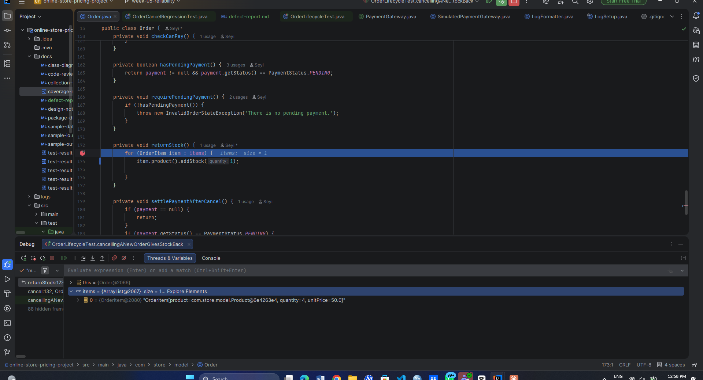

# Defect report: cancelling an order did not return all the stock

**Reported by:** Seyi   **Date:** 2026-10-28   **Found by:** existing unit test, then the IDE debugger

## Symptoms
After cancelling an order that contained 4 notebooks, the notebook stock went up by only 1 instead of 4.
Starting stock was 10. The order took 4, leaving 6. After the cancel, stock should have been 10 again, but it was 7.

The test `cancellingANewOrderGivesStockBack` failed with:

```
expected: <10> but was: <7>
```

## Stack trace
```
org.opentest4j.AssertionFailedError: expected: <10> but was: <7>
    (JUnit framework lines removed)
    at com.store.model.OrderLifecycleTest.cancellingANewOrderGivesStockBack(OrderLifecycleTest.java:115)
```

The trace ends in the test, at the `assertEquals` line. That shows where the problem was **noticed**, not where it was **caused**.
The real cause is in `Order.returnStock()`, which the trace does not mention.

## Root cause
In `Order.returnStock()`, the line inside the loop was `item.product().addStock(1);`.
It always returned 1 unit to stock, whatever quantity was in the order item.
It should have returned the quantity of that item: `item.quantity()`.

## Debugging steps
1. I ran all the tests and saw that `cancellingANewOrderGivesStockBack` was red, with `expected: <10> but was: <7>`.
2. The stack trace only pointed at the assertion in the test, so I could not see the cause from it. I decided to watch the code run.
3. I put a breakpoint on the `returnStock()` call in `cancel()` and another on the first line inside the `for` loop in `returnStock()`.
4. I right-clicked the test and chose Debug. The program stopped at the loop.
5. In the Variables panel I saw `items` with size 1, and its only element was `OrderItem[... quantity=4, unitPrice=50.0]`. So the order really held 4 notebooks.
6. I looked at the next line, `item.product().addStock(1)`, and saw that it passed the number 1 instead of the item's quantity. That is why 4 notebooks were taken out and only 1 came back.

Evidence: 

## Correction
I changed `addStock(1)` to `addStock(item.quantity())` in `Order.returnStock()`.
Fix commit: b4aa1a0 ("Fix cancel returning only one unit of stock").
After the fix, `cancellingANewOrderGivesStockBack` passed again, and all the other tests still passed.

## Regression test
`OrderCancelRegressionTest.cancellingAnOrderWithSeveralLinesReturnsAllUnitsToStock` adds two different products
to an order (4 notebooks and 25 pens), cancels it, and checks that both products return to their original stock
(10 and 100). If someone brings the bug back, this test fails again.
A test with two lines is stronger than the original test, because the bug would also have shown up in only the
first product of a mixed order.

## Lesson learned
A failing test tells you *that* something is wrong and *what* result was wrong, but not *why*.
The debugger let me watch the real values (`quantity=4`) as the code ran, which showed me the cause faster than
reading the code would have. Adding a regression test means the same mistake cannot return without being noticed.